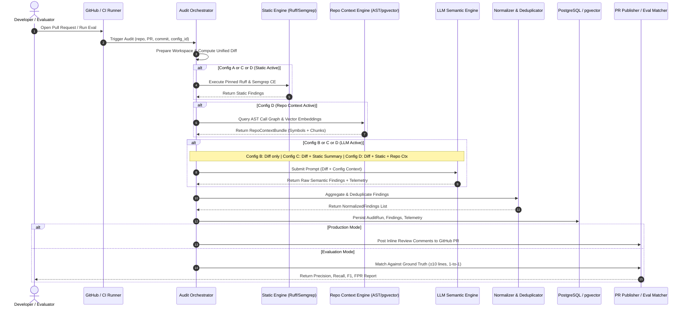
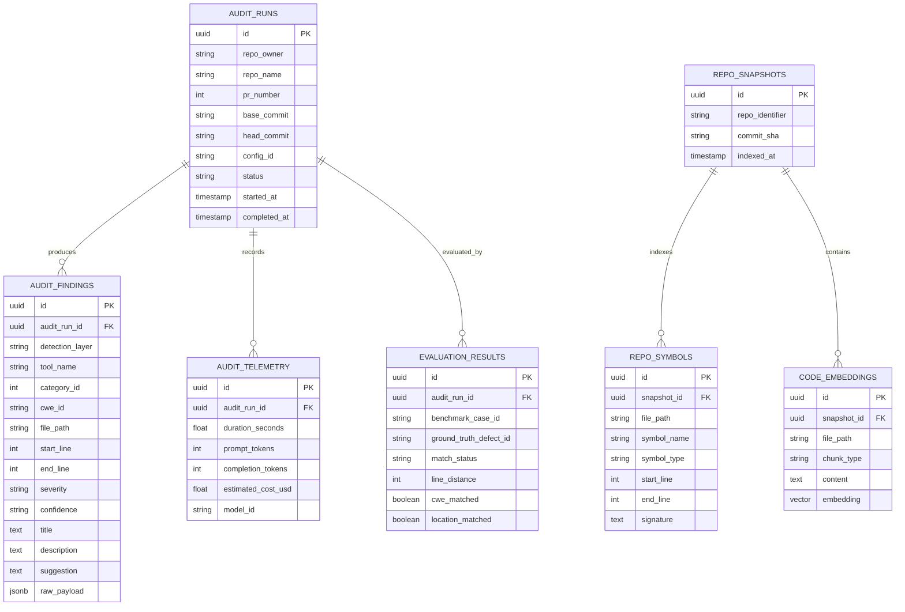

# AI Code Auditor — System Architecture Specification

## Document Information
- **Document Version**: Version 1.2 — Formalized Approved Architecture & Frozen Operational Policies
- **Date**: 2026-10-09
- **Project**: Automated Code Review and Bug Detection System (AI Code Auditor)
- **Student**: Bùi Vạn Khải (MSSV: 24520719)
- **Supervisor**: ThS. Trần Thị Hồng Yến
- **Institution**: Trường Đại học Công nghệ Thông tin — ĐHQG-HCM
- **Status**: APPROVED CORE ARCHITECTURE SPECIFICATION — Student-Approved Core Decisions (ADR-01, ADR-03, ADR-07, ADR-08 Formalized; Static Analysis & Partial-Run Policies Frozen). Production implementation ready for Configuration A.

---

## 1. System Context & Boundaries

### 1.1 Context Overview
The **AI Code Auditor** is an automated Pull Request auditing and defect detection system specifically scoped for Python web backend projects (FastAPI and Flask). It bridges the gap between fast, deterministic static analysis tools (which operate intra-file and lack semantic intent) and Large Language Models (which suffer from hallucinations, high token costs, and lack of repository-wide context).

The system operates primarily within a GitHub Pull Request workflow: it ingests PR change events, acquires code diffs and relevant repository context, executes a multi-layered audit pipeline across configurable experimental modes, and publishes actionable, deduplicated review feedback directly to the Pull Request.

### 1.2 System Actors & External Systems
- **Primary Users**:
  - *PR Authors / Developers*: Receive structured inline feedback and defect explanations on open Pull Requests.
  - *Lead Engineers / Code Reviewers*: Benefit from automated triage of routine syntax, logic, and security defects.
  - *Thesis Evaluators / Researchers*: Utilize the dedicated, decoupled benchmark evaluation harness to run reproducible comparisons across experimental configurations.
- **External Systems**:
  - *GitHub Platform*: Delivers webhook events (`pull_request`), unified git diffs, file trees, and receives inline PR review comments via the GitHub REST API.
  - *GitHub Actions Runners*: Host CI workflow execution environments for automated on-commit auditing.
  - *Upstream LLM Provider APIs*: External foundation model inference endpoints (e.g., OpenAI, Anthropic, Google Gemini) accessed via API keys. No local model weights, training, or fine-tuning are in scope (supervisor-confirmed scope).
  - *PostgreSQL + pgvector Database*: Datastore for persistent audit records, telemetry, AST symbol metadata, and vector embeddings for semantic context retrieval.

### 1.3 Trust Boundaries & Threat Perimeter
```
+---------------------------------------------------------------------------------------+
| UNTRUSTED EXTERNAL ZONE                                                               |
|  - GitHub Webhook Payloads (unverified headers, spoofed payloads)                     |
|  - PR Code Diffs, Source Files, Branch Names, Commit Messages (Prompt Injection risk)  |
|  - Target Repository Configuration (.gitmodules, symlinks, git hooks)                 |
+---------------------------------------------------------------------------------------+
                                        | (HMAC Signature Verification / GitHub App Auth)
                                        v
+---------------------------------------------------------------------------------------+
| TRUSTED AUDITOR PERIMETER                                                             |
|  - Intake Controller & Signature Verifier                                             |
|  - Isolated Local Workspace / Sandbox Filesystem (Hooks disabled, symlinks checked)   |
|  - Core Orchestrator Engine & Configuration Dispatcher                                |
|  - Static Analysis Wrapper (Pinned Ruff & Semgrep CE; untrusted repo configs ignored) |
|  - AST & Semantic Context Retrieval Engines                                           |
|  - Prompt Formulation & Boundary Sanitizer (Defense-in-depth delimiter blocks)        |
|  - Finding Normalizer & Deduplicator                                                  |
|  - PostgreSQL / pgvector Storage & Secrets Manager                                    |
+---------------------------------------------------------------------------------------+
                                        | (Encrypted TLS API Calls / Structured Prompts)
                                        v
+---------------------------------------------------------------------------------------+
| THIRD-PARTY INFERENCE ZONE                                                            |
|  - External LLM API Providers (Ephemeral inference, zero training retention)          |
+---------------------------------------------------------------------------------------+
```

### 1.4 Core System Responsibilities
1. **Intake & Verification**: Ingest GitHub PR triggers, verify webhook signatures (`X-Hub-Signature-256`), and resolve repository coordinates.
2. **Repository Revision Isolation**: Fetch exact `base` and `head` commit trees into an isolated, ephemeral workspace without executing untrusted repository hooks.
3. **Deterministic Static Analysis**: Execute pinned Ruff (linting, basic smells, Bandit security rules) and Semgrep Community Edition (AST structural patterns, taint tracking) against changed files.
4. **Repository Context Retrieval**:
   - Extract structural AST definitions, call graphs, and type signatures from the repository.
   - Index and retrieve relevant cross-file context using pgvector embeddings.
   - Sieve and prune context within a provisional token budget.
5. **Heuristic LLM Semantic Review**: Formulate structured prompts containing isolated diffs and retrieved context; query LLM API with automated retries and schema enforcement.
6. **Finding Normalization & Deduplication**: Normalize file paths and 1-indexed line numbers; map candidate CWEs; eliminate redundant findings across static and LLM layers; attach provenance metadata.
7. **Publication & Persistence**: Post non-redundant review comments to the PR; record complete audit history, execution telemetry, and token metrics to PostgreSQL.
8. **Quantitative Evaluation Harness**: An offline, decoupled benchmark runner executing Configurations A–D against ground-truth datasets using locked $\pm 10$ line matching tolerance and 1-to-1 consumption rules.

### 1.5 Explicit Scope Exclusions & Operational Boundaries
- **No Model Training or Fine-Tuning**: System relies entirely on API-based orchestration of established commercial/open LLMs (supervisor-confirmed scope).
- **No Non-Python Languages**: Strictly restricted to Python web backends (FastAPI and Flask).
- **No AI Guardrail in Core MVP**: Guardrail rules for AI-generated code remain an advanced stretch research direction, deferred outside the Core MVP (supervisor-confirmed scope).
- **No Untrusted Code Execution in Reviewer**: The review pipeline statically inspects source code; it **never** runs `pytest`, `unittest`, `eval()`, or `importlib` against the target repository during Pull Request audits.
- **No Multi-Tenant SaaS Overhead**: The Core MVP is designed as a single-tenant, self-contained system deployable within CI runners or a lightweight backend service.

---

## 2. Component Architecture

To minimize operational complexity and maintain framework independence, the architecture defines a **framework-agnostic core engine** (`auditor.core`) separated from delivery adapters (`auditor.cli`, `auditor.api`).

```
+-----------------------------------------------------------------------------------+
|                        FRAMEWORK-INDEPENDENT CORE ENGINE                          |
+-----------------------------------------------------------------------------------+
|  [Orchestrator]          Audit Orchestrator & Configuration Dispatcher (A, B, C, D)|
|  [Workspace Engine]      Git Revision Manager | Diff Parser | Sandbox Isolator    |
|  [Static Engine]         Pinned Ruff Wrapper  | Pinned Semgrep CE Taint Wrapper   |
|  [Context Engine]        AST Symbol Analyzer  | pgvector Semantic Retriever       |
|  [LLM Engine]            Prompt Formulator    | Abstract LLM Client | Validator   |
|  [Normalizer & Agg]      Finding Normalizer & Deduplicator | Provenance Tracker   |
|  [Evaluation Matcher]    Decoupled Benchmark Ground-Truth Matcher (±10 lines)     |
+-----------------------------------------------------------------------------------+
                                         ^
                                         | Invocations & Data Flow
        +--------------------------------+--------------------------------+
        |                                                                 |
+-----------------------------------+   +-----------------------------------+
|        CLI / CI RUNNER            |   |       HTTP SERVICE ADAPTER        |
|  (GitHub Actions & Local Eval)    |   |  (Webhook Intake & REST API)      |
|  - CLI Entrypoint (`auditor.cli`) |   |  - Webhook Endpoint Receiver      |
|  - Offline Benchmark Runner       |   |  - Background Job Execution       |
|  - Standalone PR Auditing         |   |    (FastAPI recommended, Flask alt)|
+-----------------------------------+   +-----------------------------------+
                                         |
                                         v
+-----------------------------------------------------------------------------------+
|                               PERSISTENCE ADAPTER                                 |
|  PostgreSQL Client | pgvector Storage | Relational Telemetry & Audit Runs         |
+-----------------------------------------------------------------------------------+
```

### 2.1 Component Specifications

#### Component 1: Delivery Adapters (CLI Runner & Webhook API Adapter)
- **Responsibility**: Ingest audit requests from either command-line invocations (in GitHub Actions workflows or evaluation test runs) or incoming GitHub webhook HTTP requests.
- **Framework Neutrality & Approved Backend**: The core orchestrator accepts a generic `AuditRequest` and produces an `AuditResult`. Per **ADR-01** and **ADR-03** (Approved), the system uses a modular Python monolith with a framework-independent core; FastAPI is the approved backend adapter for webhook intake and REST endpoints.
- **Task Execution Model**: Per **ADR-08** (Approved), the system follows a CLI-first architecture with FastAPI `BackgroundTasks` for lightweight in-process background execution (Celery/Redis deferred).
- **ADR-08 Operational Limitation**: In-process background tasks do NOT provide durable job persistence or automatic recovery across process restarts or crashes. An interrupted or crashed background audit job must be explicitly recorded and visible as incomplete or failed, never silently reported as successfully audited.
- **Inputs**: CLI flags (`--repo`, `--pr`, `--config`) or HTTP Webhook payloads (`X-GitHub-Event: pull_request`).
- **Outputs**: Instantiated `AuditContext`.
- **Principal Failure Modes**: Invalid webhook signature (reject HTTP 401), missing git revision arguments, unauthenticated API calls, unhandled process crash during in-process background execution.

#### Component 2: Workspace & Revision Manager
- **Responsibility**: Manage the local repository checkout. Ensure working tree reflects exact `head` commit revision with `base` revision accessible for computing clean unified diffs.
- **Security Boundaries**: Disables local git hooks (`core.hooksPath=/dev/null`), rejects recursive untrusted submodules, and resolves paths to prevent symlink traversal outside the target workspace.
- **Inputs**: Repository URL / path, `base_commit_sha`, `head_commit_sha`.
- **Outputs**: Local isolated workspace path, structured unified diff hunks, list of modified/added files.
- **Principal Failure Modes**: Shallow clone preventing merge base calculation, corrupt git tree, checkout timeout.

#### Component 3: Deterministic Static Analysis Engine
- **Responsibility**: Execute deterministic linters and intra-file security rules against changed Python files.
- **Rule Isolation & Approved Static Policy (FR-03 Frozen)**:
  - Uses pinned tool binaries (Ruff CLI and Semgrep Community Edition CLI) with an **auditor-managed, version-pinned rule pack**, explicitly superseding unpinned auto-configuration (`semgrep scan --config auto`).
  - *Controlled Semgrep Configuration*: Pinned Semgrep version, rule-pack identity, and revision are recorded; the identical frozen rule pack is executed across comparable experiments; rules are strictly frozen without post-hoc tuning on benchmark cases; offline availability, reproducibility, and third-party rule licensing are verified prior to execution.
  - *Repository-Controlled Suppression Policy*: The primary benchmark scoring path strictly forbids target-repository configuration or suppression directives from silently hiding findings. This explicitly isolates against: inline `# noqa` directives, repository `ruff.toml` and `pyproject.toml` configurations (including exclusions and `per-file-ignores`), inline Semgrep `nosemgrep` directives, `.semgrepignore` files, and `.gitignore`-driven skipping.
  - *Isolation Strategy*: The engine analyzes a controlled copy of relevant source files using auditor-managed configuration without inheriting target-repository tool configs or ignore files. Inline directives in source copies require explicit handling. Tool CLI flags are not hardcoded until verified against exact pinned tool versions and validated with adversarial test fixtures in the implementation phase. Any operational suppression behavior is kept strictly distinct from the primary benchmark scoring path.
- **Tools & Frozen Ruleset Manifest**:
  - *Manifest Contract*: Defined and frozen at [`ruleset_manifest.json`](file:///d:/Khai%20Van/KhaiVan%20Data/CODE/AI_Code_Auditor_Thesis1/src/auditor/static_analysis/ruleset_manifest.json) containing 286 mapped rules (88 Ruff rules + 198 Semgrep rules).
  - *Ruff (v0.16.10)*: Fast syntactic hygiene, Bugbear logic bugs (`B` series, `F601`..`F634`), and Flake8-bandit security rules (`S` series, S101..S704). CLI flags: `--isolated --ignore-noqa --no-respect-gitignore --no-cache --output-format json`. License: MIT / Apache-2.0.
  - *Semgrep CE (v1.180.0)*: Intra-file AST pattern matching and taint tracking (`mode: taint`) using the frozen offline vendor pack at [`python_security.yaml`](file:///d:/Khai%20Van/KhaiVan%20Data/CODE/AI_Code_Auditor_Thesis1/src/auditor/static_analysis/rules/semgrep/python_security.yaml). CLI flags: `--config <rules_path> --disable-version-check --metrics=off --no-git-ignore --json`. License: Semgrep Rules License v1.0 / Community.
  - *Unmapped Rule Policy*: Any unmapped rule finding is assigned `category_id=1`, `primary_cwe="CWE-UNMAPPED"`. It strictly scores as a False Positive (FP) against ground truth; never silently suppressed or arbitrarily reassigned.
- **Inputs**: Workspace path, list of modified Python file paths.
- **Outputs**: List of normalized predicted findings (`detection_layer: deterministic_static`).
- **Principal Failure Modes**: Static analysis CLI timeout, non-zero tool exit code on syntax errors (must log and continue, not crash pipeline).

#### Component 4: Repository Analysis & Context Retrieval Engine
- **Responsibility**: Extract repository-wide context relevant to the modified code without causing context window saturation.
- **Sub-modules**:
  - *AST Symbol Analyzer*: Parses local Python AST to identify modified functions, callers, callees, class hierarchies, and type definitions.
  - *Semantic Vector Retriever*: Embeds modified diff hunks and retrieves top-$K$ similar codebase chunks from PostgreSQL/pgvector.
  - *Context Slicer & Budget Manager*: Assembles structural AST definitions and vector chunks, enforcing an experimental token budget cap.
- **Status Note (ADR-07 Approved)**: The two-stage AST and pgvector repository-context retrieval strategy is formally **APPROVED** per ADR-07. The 4,000-token budget (ceiling 8,000 tokens) is treated as an **initial experimental budget**, not an established optimum, subject to empirical validation during benchmark evaluation.
- **Inputs**: Workspace path, modified files, diff hunks, configuration ID.
- **Outputs**: `RepoContextBundle` (formatted code snippets, symbol definitions, call relationships).
- **Principal Failure Modes**: Database connection loss, embedding API rate limit, oversized repository indexing timeout.

#### Component 5: LLM Semantic Review Engine
- **Responsibility**: Formulate prompts, query external LLM APIs, and extract structured defect findings.
- **Sub-modules**:
  - *Prompt Formulator*: Combines system instructions, taxonomy rules, PR diff, and retrieved repo context using explicit isolation delimiters.
  - *Abstract LLM Client*: Provider-agnostic interface (`LLMClientInterface`, mandated by NFR-06) supporting interchangeable backends (OpenAI, Anthropic, Gemini).
  - *Response Validator*: Parses LLM output against Pydantic schema with automatic retry on malformed JSON.
- **Inputs**: Diff hunks, optional `RepoContextBundle`, configuration ID.
- **Outputs**: List of raw semantic findings (`detection_layer: heuristic_llm`), token usage metrics, latency.
- **Principal Failure Modes**: API rate limits (HTTP 429), gateway timeouts (HTTP 504), context window overflow, hallucinated invalid JSON schema.

#### Component 6: Finding Normalizer, Deduplicator & Aggregator
- **Responsibility**: Harmonize findings from static analysis and LLM review into a unified schema; eliminate duplicate alerts; enforce category and CWE alignment.
- **Inputs**: Lists of raw static findings and raw LLM findings.
- **Outputs**: Clean, prioritized list of `NormalizedFinding` records with full provenance metadata.
- **Principal Failure Modes**: Overlapping findings spanning divergent line coordinates, misclassified CWE tags.

#### Component 7: Persistence & Telemetry Store
- **Responsibility**: Record complete audit lifecycle, execution metadata, token counts, cost estimates, and normalized findings in PostgreSQL.
- **Inputs**: `AuditContext`, `NormalizedFinding` list, telemetry metrics.
- **Outputs**: Persisted database entities.
- **Principal Failure Modes**: Database constraint violation, connection timeout.

#### Component 8: GitHub Review Publisher
- **Responsibility**: Format findings into actionable markdown comments and post them to the GitHub PR via REST API.
- **Inputs**: PR coordinates, `NormalizedFinding` list, GitHub token.
- **Outputs**: Published PR review comments.
- **Principal Failure Modes**: Secondary GitHub API rate limits, lack of write permissions, duplicate comment posting.

#### Component 9: Evaluation Harness & Benchmark Matcher (Decoupled Evaluation Artifact)
- **Responsibility**: Execute Configurations A–D against ground-truth benchmark datasets; apply locked evaluation rules ($\pm 10$ lines locus tolerance, exact normalized file match, category/CWE match, 1-to-1 consumption); calculate Precision, Recall, F1, FPR, latency, and cost.
- **Decoupling**: Strictly independent of GitHub publication or webhook servers (mandated by FR-09).
- **Inputs**: Benchmark dataset cases (`dataset_design_test_case_list.md` / `candidate_queue.md`), target configuration ID.
- **Outputs**: `EvaluationReport` (confusion matrix, TP/FP/FN counts, diagnostic metrics).
- **Principal Failure Modes**: Ground-truth locus format mismatch, missing test fixture repositories.

---

## 3. End-to-End Audit Flow

### 3.1 Trace of a Pull Request Audit
1. **Intake Trigger**: GitHub sends a `pull_request` event (opened/synchronize) to the Webhook adapter, or developer/evaluator triggers CLI runner.
2. **Workspace Setup**: Git checks out `head` commit revision; diff computed against `base`.
3. **Configuration Execution**:
   - **Configuration A (Static Baseline)**: Execute Ruff and Semgrep CE $\rightarrow$ Normalize static findings $\rightarrow$ Skip LLM $\rightarrow$ Persist & Publish/Evaluate.
   - **Configuration B (Isolated LLM Baseline)**: Extract diff & enclosing file $\rightarrow$ Call LLM directly (zero static analysis, zero repo context) $\rightarrow$ Normalize LLM findings $\rightarrow$ Persist & Publish/Evaluate.
   - **Configuration C (Hybrid, No Repo Context)**: Execute Ruff and Semgrep CE $\rightarrow$ Extract diff $\rightarrow$ Provide diff and static findings summary to LLM (zero repo context) $\rightarrow$ Aggregate and deduplicate static + LLM findings $\rightarrow$ Persist & Publish/Evaluate.
   - **Configuration D (Hybrid with Repo Context)**: Execute Ruff and Semgrep CE $\rightarrow$ Extract diff $\rightarrow$ Retrieve AST symbols and pgvector semantic chunks $\rightarrow$ Construct context-augmented prompt $\rightarrow$ Call LLM $\rightarrow$ Aggregate and deduplicate static + LLM findings $\rightarrow$ Persist & Publish/Evaluate.
4. **Publish / Persist**: Findings formatted and posted to GitHub PR; audit record saved to PostgreSQL.

### 3.2 Sequence Diagram


---

## 4. Configuration A–D Execution Matrix

The four experimental configurations represent the core scientific comparison of the thesis. The architecture enforces strict execution gating:

| Configuration ID | Experimental Role | Static Layer (Ruff + Semgrep) | LLM Semantic Layer | AST Structural Context | Vector Semantic Context (pgvector) | Context Window Provided to LLM |
| :---: | :--- | :---: | :---: | :---: | :---: | :--- |
| **A** | Static Analysis Baseline | **ACTIVE** | *INACTIVE* | *INACTIVE* | *INACTIVE* | *None (LLM is not invoked)* |
| **B** | Isolated LLM Baseline | *INACTIVE* | **ACTIVE** | *INACTIVE* | *INACTIVE* | Unified diff hunks + enclosing file contents only |
| **C** | Hybrid Audit (No Repo Context) | **ACTIVE** | **ACTIVE** | *INACTIVE* | *INACTIVE* | Unified diff hunks + enclosing file contents + summary of static analysis findings *(Note: static findings summary is NOT repository context)* |
| **D** | Hybrid Audit + Repo Context | **ACTIVE** | **ACTIVE** | **ACTIVE** | **ACTIVE** | Unified diff hunks + enclosing file + AST symbol signatures/callers + retrieved pgvector chunks + static findings |

### 4.1 Prevention of Configuration Leakage
- **Parameter Immutability**: `config_id` (`A`, `B`, `C`, `D`) is an immutable field on the `AuditContext` object created at run instantiation.
- **Strict Execution Gating**: Component calls are gated strictly by condition checks; inactive components are never initialized or invoked.
- **Subprocess Isolation in Evaluation**: In evaluation mode, each configuration run executes as a separate subprocess with fresh state, ensuring zero in-memory caching of embeddings or LLM responses across configurations.
- **Telemetry Tagging**: All persisted records and findings carry an explicit `config_id` column.

---

## 5. Repository-Level Context Design

### 5.1 Two-Stage Retrieval Architecture (ADR-07 Approved)
To supply cross-file context without token exhaustion:
1. **Tier 1 — Deterministic AST Dependency Resolution**:
   - Uses Python's standard library `ast` module.
   - For all functions and classes modified in the PR diff, extract:
     - Definitions of imported functions, classes, and types referenced within modified lines.
     - Call-sites and caller definitions within immediate upstream files in the same repository.
     - Type annotations and docstrings of referenced interfaces.
2. **Tier 2 — Semantic Vector Retrieval via pgvector**:
   - Repository source files are pre-chunked by AST boundaries (functions/classes).
   - Chunks are embedded and stored in PostgreSQL using the `pgvector` extension.
   - For a given PR diff, query pgvector using cosine distance (`<=>`) to retrieve top-$K$ ($K=3\text{--}5$) code chunks most semantically relevant to the modified logic.
3. **Experimental Token Budgeting**:
   - Per ADR-07 (Approved), the context injected into the LLM prompt is initialized with an **experimental budget of 4,000 tokens** (ceiling 8,000 tokens for large diffs), treated strictly as an initial baseline rather than an established optimum.
   - Priority queue: Modified Diff Hunks (P0) $\rightarrow$ AST Direct Dependencies (P1) $\rightarrow$ Static Analysis Summaries (P2) $\rightarrow$ Retrieved Vector Chunks (P3).
   - If token budget is exceeded, P3 chunks are truncated first, preserving critical structural definitions.

### 5.2 Parameters Requiring Empirical Benchmarking
The following context retrieval parameters are **provisional recommendations** that must be tuned empirically using the development dataset (30 Dev PRs):
- Optimal embedding chunk size (function level vs. block level).
- Number of retrieved vector chunks ($K=3$ vs. $K=5$).
- Call graph traversal depth (depth-1 immediate callers vs. depth-2 transitive callers).
- Exact token budget threshold (3,000 vs. 4,000 vs. 6,000 tokens) balanced against LLM API cost and latency.

---

## 6. Data & Persistence Design

The persistence layer uses **PostgreSQL** with the **`pgvector`** extension (validated stack selection). The logical data model supports both live Pull Request auditing and quantitative benchmark evaluation.



*Note*: The physical table definitions, schema migrations (via Alembic), and vector index indexing strategy (HNSW vs. IVFFlat) are proposed designs subject to final implementation approval.

---

## 7. API & Integration Contracts

### 7.1 HTTP Webhook & REST Endpoints (ADR-03 Approved)
*(FastAPI approved backend implementation; core auditing logic remains framework-independent)*

#### 7.1.1 Overview & Common Conventions

- **Transport & Encoding**: HTTPS, `Content-Type: application/json` (UTF-8).
- **Authentication & Authorization**:
  - `POST /api/v1/webhooks/github`: Authenticated exclusively via GitHub HMAC-SHA256 signature header (`X-Hub-Signature-256`) using a shared webhook secret.
  - REST endpoints (`/api/v1/audits*`): In the Core MVP, designed for trusted internal deployment (e.g. CI runner or private network). An API key or Bearer token header (`Authorization: Bearer <token>`) is acknowledged as a proposed production authorization boundary, but remains an unresolved design proposal pending student approval.
- **Execution Model (ADR-08)**: Asynchronous in-process task execution via FastAPI `BackgroundTasks`. Audit trigger endpoints validate request payloads, persist initial state, enqueue execution, and immediately return HTTP `202 Accepted` with an audit resource identifier (`audit_id`). Callers poll `GET /api/v1/audits/{audit_id}` to inspect status and retrieve findings upon completion.
- **Unified Error Response Format**:
  All client (`4xx`) and server (`5xx`) errors return a consistent **project-specific JSON error envelope**:
  ```json
  {
    "error": {
      "code": "INVALID_SIGNATURE",
      "message": "Provided X-Hub-Signature-256 header does not match computed HMAC digest.",
      "details": null
    }
  }
  ```
  *Field Specifications*:
  - `error.code` (String, required): Stable machine-readable error token (e.g., `INVALID_SIGNATURE`, `INVALID_REQUEST`, `NOT_FOUND`).
  - `error.message` (String, required): Human-readable explanatory description.
  - `error.details` (Object or Null, optional): Contextual dictionary of validation failures or additional diagnostic data.

---

#### 7.1.2 Endpoint Specifications

##### 1. `POST /api/v1/webhooks/github`
- **Purpose**: Receive GitHub Pull Request webhook event notifications, verify cryptographic provenance, extract PR coordinates, enqueue audit run, and return immediate acknowledgment.
- **Caller**: GitHub Webhook Delivery Infrastructure.
- **HTTP Method & Path**: `POST /api/v1/webhooks/github`
- **Required Headers**:
  - `X-GitHub-Event`: Must equal `pull_request`.
  - `X-Hub-Signature-256`: Hexadecimal HMAC-SHA256 digest prefixed with `sha256=`.
  - `Content-Type`: `application/json`
- **Signature Verification Algorithm**:
  1. The server reads the raw, unparsed request payload bytes.
  2. The server computes the HMAC-SHA256 digest of the raw bytes using the configured `GITHUB_WEBHOOK_SECRET`.
  3. The server compares the computed digest against the received `X-Hub-Signature-256` value using constant-time comparison (`hmac.compare_digest`).
  4. If the signature is missing or does not match, the request is immediately rejected with HTTP `401 Unauthorized` without enqueuing work.
- **Request Body (Excerpt of GitHub `PullRequestEvent`)**:
  ```json
  {
    "action": "opened",
    "number": 42,
    "pull_request": {
      "number": 42,
      "head": {
        "sha": "90120dd6e8a1234567890abcdef1234567890abc"
      },
      "base": {
        "sha": "fa7e3c996edf2d5482fff8f9d890ac2390dede4d"
      }
    },
    "repository": {
      "full_name": "tiangolo/fastapi"
    }
  }
  ```
- **Domain Handoff**:
  The handler maps the event payload to an internal `AuditRequest`:
  - `request_id = "gh-webhook-" + uuid4().hex`
  - `repository_id = payload["repository"]["full_name"]`
  - `pr_number = payload["number"]`
  - `head_commit = payload["pull_request"]["head"]["sha"]`
  - `base_commit = payload["pull_request"]["base"]["sha"]`
  - `configuration = AuditConfiguration.D` (or project default)
  The request is enqueued to `BackgroundTasks.add_task(dispatcher.dispatch, audit_request)`.
- **Success Response (HTTP 202 Accepted)**:
  ```json
  {
    "audit_id": "audit-3f8a9e1b2c4d",
    "status": "pending",
    "repository_id": "tiangolo/fastapi",
    "pr_number": 42,
    "head_commit": "90120dd6e8a1234567890abcdef1234567890abc",
    "message": "Audit enqueued for background execution."
  }
  ```
- **Error Responses**:
  - `400 Bad Request`: Unsupported event action or malformed JSON payload.
  - `401 Unauthorized`: Invalid or missing `X-Hub-Signature-256`.

---

##### 2. `POST /api/v1/audits`
- **Purpose**: Programmatically or manually trigger an audit on a designated repository, commit revision, and configuration without requiring a GitHub webhook trigger.
- **Caller**: CI/CD Pipelines (e.g. GitHub Actions runner, local test scripts, external orchestrator).
- **HTTP Method & Path**: `POST /api/v1/audits`
- **Required Headers**: `Content-Type: application/json`
- **Request Body (`AuditRequest` JSON schema)**:
  ```json
  {
    "request_id": "req-custom-001",
    "repository_id": "pallets/werkzeug",
    "pr_number": 105,
    "head_commit": "50cfeebcb01234567890abcdef1234567890abc",
    "base_commit": "2767bcb10a1234567890abcdef1234567890abc",
    "configuration": "A",
    "workspace_path": "/tmp/workspaces/werkzeug_pr_105"
  }
  ```
- **Field Constraints**:
  - `request_id`: String, mandatory unique idempotency key.
  - `repository_id`: String, mandatory repository identifier (`owner/repo`).
  - `pr_number`: Integer, optional.
  - `head_commit`: String, mandatory Git commit SHA (40-hex string).
  - `base_commit`: String, optional Git commit SHA.
  - `configuration`: Enum string, must be one of `"A"`, `"B"`, `"C"`, `"D"` (defaults to `"D"`).
  - `workspace_path`: String, optional local workspace folder path.
- **Domain Handoff**:
  Instantiates `AuditRequest` Pydantic model directly, registers audit record in storage (`status = "pending"`), and enqueues `dispatcher.dispatch(audit_request)`.
- **Success Response (HTTP 202 Accepted)**:
  ```json
  {
    "audit_id": "audit-7e4c2a1f9b8d",
    "request_id": "req-custom-001",
    "status": "pending",
    "configuration": "A",
    "created_at": "2026-10-10T11:45:00Z"
  }
  ```
- **Error Responses**:
  - `400 Bad Request`: Field validation error (invalid configuration enum or invalid commit SHA format).
  - `422 Unprocessable Entity`: Syntactically valid JSON missing mandatory Pydantic model fields.

---

##### 3. `GET /api/v1/audits/{audit_id}`
- **Purpose**: Inspect the current lifecycle state, error message, duration, and telemetry summary of an audit execution run.
- **Caller**: Pull Request Poller, CI runner, or Monitoring Dashboard.
- **HTTP Method & Path**: `GET /api/v1/audits/{audit_id}`
- **Path Parameters**:
  - `audit_id`: String UUID identifying the audit run.
- **Success Response (HTTP 200 OK — Completed Run)**:
  ```json
  {
    "audit_id": "audit-7e4c2a1f9b8d",
    "request_id": "req-custom-001",
    "configuration": "A",
    "status": "completed",
    "findings_count": 3,
    "error_message": null,
    "duration_seconds": 1.45,
    "provenance": {
      "stage": "static_only",
      "files_analyzed": 1
    },
    "created_at": "2026-10-10T11:45:00Z",
    "completed_at": "2026-10-10T11:45:01Z"
  }
  ```
- **Lifecycle Status States (API Representation vs. Domain Model)**:
  - `"pending"`: API-level state. Request enqueued in in-process `BackgroundTasks`, execution not yet started in `ConfigurationDispatcher`.
  - `"running"`: API-level state. Active analysis currently executing in `ConfigurationDispatcher`.
  - `"completed"`: Maps from domain `AuditStatus.SUCCESS` (`src/auditor/models/result.py`). Successfully finished with full or zero findings.
  - `"partial"`: Maps from domain `AuditStatus.PARTIAL` (`src/auditor/models/result.py`). Execution finished with degraded non-critical failure (e.g. LLM failure degraded to static-only findings).
  - `"failed"`: Maps from domain `AuditStatus.FAILED` (`src/auditor/models/result.py`). Critical failure (e.g. diff acquisition crash, syntax error abort).
- **Error Responses**:
  - `404 Not Found`: Specified `audit_id` does not exist in store.

---

##### 4. `GET /api/v1/audits/{audit_id}/findings`
- **Purpose**: Retrieve the list of normalized findings emitted by an audit run.
- **Caller**: GitHub PR Review Publisher adapter, CLI reporter, or client viewer.
- **HTTP Method & Path**: `GET /api/v1/audits/{audit_id}/findings`
- **Path Parameters**:
  - `audit_id`: String UUID identifying the audit run.
- **Success Response (HTTP 200 OK)**:
  ```json
  {
    "audit_id": "audit-7e4c2a1f9b8d",
    "total_findings": 1,
    "findings": [
      {
        "finding_id": "static-ruff-s101-42",
        "detection_layer": "deterministic_static",
        "tool_name": "ruff",
        "category_id": 1,
        "primary_cwe": "CWE-670",
        "alternative_cwes": [],
        "file_path": "src/utils/cache.py",
        "start_line": 42,
        "end_line": 42,
        "severity": "medium",
        "confidence": "high",
        "title": "Assert detected in non-test file",
        "description": "Use of assert detected; assert statements are removed in optimized Python bytecode.",
        "suggestion": "Replace assert statement with explicit conditional exception.",
        "provenance": {
          "tool": "ruff",
          "rule_code": "S101"
        }
      }
    ]
  }
  ```
- **Error Responses**:
  - `404 Not Found`: `audit_id` does not exist.
  - `409 Conflict`: Audit execution is still `"pending"` or `"running"`; findings are not yet finalized.

---

##### 5. `POST /api/v1/evaluations/run` (Status: Proposed / Deferred to Dedicated Benchmark Tools)
- **Status & Scope Distinction**:
  Per **ADR-09** (Locked), the evaluation harness is a **decoupled offline evaluation artifact** that reads ground-truth datasets directly and runs independently of webhook or REST service layers.
- **Design Assessment**:
  Triggering batch benchmark evaluations across Configurations A–D via an HTTP endpoint is designated as an **optional future convenience endpoint** for evaluation automation. In the Core MVP, evaluation is executed strictly through offline benchmark CLI tools (`tools/run_config_{a,b,c,d}_pilot.py`) to prevent HTTP gateway timeouts on multi-minute batch benchmark runs and eliminate web server dependencies during research measurements.
- **Proposed Future Schema**:
  ```json
  {
    "dataset_path": "data/pilot_cases.json",
    "configurations": ["A", "B", "C", "D"],
    "output_dir": "data/results"
  }
  ```
  Returns HTTP `202 Accepted` with an `evaluation_run_id` when implemented.

---

### 7.2 Internal Data Contracts (Pydantic Schemas)

```python
from enum import Enum
from typing import List, Optional
from pydantic import BaseModel, Field

class ConfigType(str, Enum):
    CONFIG_A = "A"
    CONFIG_B = "B"
    CONFIG_C = "C"
    CONFIG_D = "D"

class DetectionLayer(str, Enum):
    DETERMINISTIC_STATIC = "deterministic_static"
    HEURISTIC_LLM = "heuristic_llm"

class NormalizedFinding(BaseModel):
    finding_id: str
    detection_layer: DetectionLayer
    tool_name: str
    category_id: int = Field(ge=1, le=6)
    primary_cwe: str
    alternative_cwes: List[str] = Field(default_factory=list)
    file_path: str
    start_line: int
    end_line: int
    severity: str  # low | medium | high | critical
    confidence: str  # low | medium | high
    title: str
    description: str
    suggestion: Optional[str] = None
    provenance: dict
```

---

## 8. Security & Reliability: Intended Controls & Residual Risks

The system handles untrusted repository code and interacts with external APIs. All security measures are designed as **intended defense-in-depth controls** accompanied by recognized **residual risks**, rather than absolute guarantees.

| Domain | Threat / Failure Mode | Intended Architecture Controls | Residual Risks & Limitations |
| :--- | :--- | :--- | :--- |
| **Prompt Injection** | Untrusted PR diffs, commit messages, or filenames contain adversarial instructions aimed at hijacking LLM output. | 1. Fenced delimiter blocks (`=== BEGIN UNTRUSTED PR CODE DIFF ===`).<br>2. Explicit system prompt immunization instructing the model to treat fenced content strictly as inert data.<br>3. Strict JSON schema enforcement via Pydantic parsing. | Delimiters provide defense-in-depth but do NOT guarantee complete immunity against sophisticated indirect prompt injection. Malformed outputs are rejected, but semantic manipulation remains an inherent LLM risk. |
| **Execution Safety** | Malicious code in target repository attempts remote code execution on the runner. | 1. The auditor strictly performs **static code analysis** (`ast`, `ruff`, `semgrep`).<br>2. Pipeline NEVER executes `pytest`, `unittest`, `eval()`, or `importlib` against target code.<br>3. Workspace checkout explicitly sets `core.hooksPath=/dev/null` to prevent executing malicious `.git/hooks`. | Symlinks in target repos must be explicitly validated during file traversal to prevent path traversal outside workspace. Untrusted submodules must be disabled (`submodule.recurse=false`). |
| **Tool Tampering** | Target repository supplies malicious `.semgrep.yml` or linter config to bypass rules or exploit tool vulnerabilities. | 1. The auditor ignores repository-local configuration files, `.semgrepignore`, `.gitignore` skip directives, inline `# noqa`, and `nosemgrep` suppression comments in the primary benchmark evaluation path.<br>2. Analysis rules and CLI binaries are pinned and supplied exclusively by the auditor container via a version-pinned rule pack. | Zero-day vulnerabilities in underlying static analysis parsers (e.g. tree-sitter or semgrep core) remain a theoretical supply-chain risk. |
| **Secrets & Tokens** | LLM API keys or GitHub tokens leak into logs, PR comments, or database records. | 1. Credentials loaded strictly from environment variables via Pydantic Settings; never logged.<br>2. Output scrubbing filter scans finding descriptions before publishing. | Accidental logging of full request payloads during debug mode could leak data; debug logging must be masked. |
| **LLM Reliability** | API rate limits (HTTP 429), gateway timeouts (504), context overflow, or malformed JSON. | 1. Exponential backoff with jitter (up to 3 retries proposed).<br>2. Single repair prompt pass on JSON validation failure.<br>3. Graceful degradation: LLM failure does not abort static findings. | Extended provider outages will cause heuristic review stages to fail; system returns partial (static-only) findings with status warning. |
| **GitHub Publishing** | Rate limits or duplicate comments posted across multiple PR synchronize events. | 1. Idempotency check: query existing PR review comments prior to posting.<br>2. Consolidated review payload (single review with multiple line comments). | Secondary GitHub API abuse limits could delay publication during high PR volume. |

---

## 9. Testing & Evaluation Architecture

### 9.1 Multi-Level Testing Strategy
1. **Unit Testing**:
   - Test AST parser on synthetic Python snippets (functions, classes, imports).
   - Test Pydantic schema validation for `NormalizedFinding` and `AuditContext`.
   - Test finding deduplication logic across overlapping static and LLM findings.
   - Test prompt formatter boundary delimitation.
2. **Integration Testing**:
   - Test Ruff and Semgrep CLI invocation using local test fixtures with known syntax and taint defects.
   - Test mock LLM client responses with simulated rate limits and malformed JSON.
   - Test PostgreSQL database migrations and pgvector similarity queries.
3. **Pipeline End-to-End Testing**:
   - Run end-to-end audit on clean and buggy synthetic PR fixtures across all four configurations (A, B, C, D).

### 9.2 Decoupled Evaluation Harness & Benchmark Matcher
The evaluation harness is an **independent evaluation artifact** decoupled from production PR review:
- Reads ground-truth benchmark cases from `dataset_design_test_case_list.md`.
- Invokes the auditor engine in evaluation mode for each case across Configurations A, B, C, and D.
- Executes the **Locked Evaluation Matching Algorithm**:
  1. *File Match*: Exact normalized file path match (case-sensitive, relative to repo root).
  2. *CWE Match*: Reported CWE matches primary CWE OR falls within pre-declared `alternative_cwe_set`.
  3. *Locus Match*: Reported line range overlaps ground truth locus OR falls within the locked tolerance window:
     $$\max(\text{start}_{\text{GT}} - 10, 1) \le \text{line}_{\text{Finding}} \le \text{end}_{\text{GT}} + 10$$
  4. *One-to-One Consumption*: Each ground-truth defect is consumed by at most one finding.
  5. *False Positive Accounting*: Extra unmatched findings on buggy PRs and all findings on clean PRs are counted as False Positives (FP). Unmatched ground-truth defects are counted as False Negatives (FN).
  6. *Operational Completion & Partial-Run Scoring Policy (FR-09 Frozen)*:
     - A successful run contributes its normalized findings to primary scoring.
     - A failed, timed-out, or partially completed run contributes **no findings** to primary scoring (all early findings emitted before failure are discarded; the run's empty prediction set is scored against ground truth, yielding 0 TPs, 0 FPs, and FNs equal to ground-truth defects).
     - Run completion metrics (success, partial, failure, timeout) and failure rates are recorded alongside detection metrics.
     - A secondary success-only sensitivity analysis is reported alongside primary results, labeled clearly as secondary (it must not replace the primary operational result).
     - Metric denominator rules: Aggregate precision is $\frac{\text{TP}}{\text{TP} + \text{FP}}$. When the denominator is zero, precision is reported as undefined/N/A rather than silently assigning 0 or 1. The same denominator rule applies to recall when ground-truth defects are zero. Per-case metrics expose undefined values explicitly without distorting aggregate metrics.
- Outputs comprehensive metric reports: Precision, Recall, F1, FPR on clean PRs, latency, token consumption, and cost.

---

## 10. Requirements-to-Architecture Traceability

The following table formally maps every requirement specified in [`requirements/functional_nonfunctional_requirements.md`](file:///d:/Khai%20Van/KhaiVan%20Data/CODE/AI_Code_Auditor_Thesis1/Project%20Documents/requirements/functional_nonfunctional_requirements.md) to the architecture design components:

| Requirement ID | Requirement Title & Summary | Responsible Architecture Component(s) | Proposed Verification Approach | Current Implementation Status | Architectural Notes & Gaps |
| :---: | :--- | :--- | :--- | :---: | :--- |
| **FR-01** | **Pull Request Intake**<br>Intake GitHub PR event, extract metadata, acquire unified diff. | Delivery Adapters (`auditor.cli`, `auditor.api`), Workspace Manager | Unit tests with synthetic webhook payloads; integration test against test repo. | Documented Design (Not Implemented) | Webhook HMAC verification and CLI flag parsing designed. |
| **FR-02** | **Repository State Acquisition**<br>Acquire source files at `head.sha`, retain base history for diff. | Workspace & Revision Manager | CI Integration test verifying working tree state and dual-commit reachability. | Documented Design (Not Implemented) | Requires git CLI or GitPython wrapper with `core.hooksPath=/dev/null` sandbox. |
| **FR-03** | **Deterministic Static Analysis**<br>Execute Ruff and Semgrep CE; emit machine-readable static findings. | Deterministic Static Analysis Engine | Automated test fixtures with known syntax, Bandit, and Semgrep taint defects. | Documented Design (Not Implemented) | Wrappers designed; static analysis policy frozen in Phase 3A: auditor-managed version-pinned rule pack (replacing `--config auto`) and target-repository suppression isolation. |
| **FR-04** | **LLM Semantic Analysis**<br>Invoke LLM via abstract API client on diff and context; emit structured findings. | LLM Semantic Review Engine | Mock LLM API test with simulated responses; JSON schema validation tests. | Documented Design (Not Implemented) | Abstract interface designed; concrete provider integration pending. |
| **FR-05** | **Configurable Repo Context Retrieval**<br>Retrieve cross-file context (AST structural definitions and vector chunks). | Repository Context Engine | Integration test on multi-file repo verifying caller/callee resolution and vector top-$K$. | Documented Design (Not Implemented) | Two-stage AST/pgvector retrieval approved (ADR-07); 4,000 tokens is initial experimental budget. |
| **FR-06** | **Finding Aggregation & Deduplication**<br>Aggregate static and LLM findings; deduplicate overlapping alerts. | Finding Normalizer & Deduplicator | Unit tests with synthetic overlapping static and LLM findings on identical loci. | Documented Design (Not Implemented) | Provenance tracking and CWE mapping logic designed. |
| **FR-07** | **GitHub Publication**<br>Format findings as markdown comments; publish to PR via GitHub REST API. | GitHub Review Publisher | Mock GitHub REST API integration test verifying comment formatting and deduplication. | Documented Design (Not Implemented) | Comment formatting designed; API rate limit backoff required. |
| **FR-08** | **Audit Run Persistence**<br>Persist audit metadata, findings, telemetry, and token metrics to database. | Persistence & Telemetry Store (PostgreSQL) | Database integration tests validating relational entities and foreign keys. | Documented Design (Not Implemented) | Entity model designed; physical migrations (Alembic) pending implementation. |
| **FR-09** | **Experimental Evaluation Mode**<br>Isolated evaluation runner executing Configs A–D against ground-truth benchmarks. | Decoupled Evaluation Harness & Benchmark Matcher | Unit test of matcher logic against synthetic TP/FP/FN cases; execution on pilot benchmark. | Documented Design (Not Implemented) | Completely decoupled from production review flow; locked ±10 lines rule codified; partial-run scoring policy frozen in Phase 3A (failed/partial runs contribute zero findings to primary scoring; secondary success-only sensitivity analysis). |
| **NFR-01** | **Execution Latency**<br>PR audit completed within $\le 180$ seconds for standard pull requests. | Orchestrator, Static Engine, LLM Engine | Latency profiling on benchmark test cases during evaluation runs. | Documented Design (Not Implemented) | Ruff (~ms) and parallel AST parsing keep latency well within budget. |
| **NFR-02** | **Evaluation Reproducibility & Variance Control**<br>Deterministic matching; locked test set; 3x repeated LLM runs. | Decoupled Evaluation Harness | Statistical variance analysis across 3 repeat runs on benchmark test set. | Documented Design (Not Implemented) | Subprocess isolation and immutable configs eliminate state leakage. |
| **NFR-03** | **Security & Credential Protection**<br>Protect credentials; prevent secret leakage; isolate untrusted code. | Workspace Manager, Security Delimiter Formatter | Static secret scanning (gitleaks) on audit logs; permission auditing. | Documented Design (Not Implemented) | Defense-in-depth delimiters designed; static inspection without code execution. |
| **NFR-04** | **Robustness & Fault Tolerance**<br>Graceful handling of API rate limits, tool crashes, and malformed outputs. | Orchestrator, LLM Client (retries), Static Engine | Fault-injection tests (simulated HTTP 429/500, corrupted static analysis outputs). | Documented Design (Not Implemented) | Exponential backoff and graceful degradation boundaries established. |
| **NFR-05** | **Observability & Audit Traceability**<br>Structured logging, telemetry recording (tokens, latency, cost per run). | Persistence & Telemetry Store | Log inspection and database verification of telemetry records for each run. | Documented Design (Not Implemented) | Telemetry schema designed (`AUDIT_TELEMETRY`). |
| **NFR-06** | **Modularity & Extensibility**<br>Abstract LLM interface; interchangeable static tools; independent evaluator. | Core Architecture, LLMClientInterface | Unit tests swapping mock LLM providers without modifying pipeline orchestrator. | Documented Design (Not Implemented) | Abstract interfaces defined for LLM, delivery adapters, and storage. |

---

## 11. Architecture Decision Register (ADR)

The following register documents the key architectural decisions, strictly classified by their authoritative status:

| ADR ID | Decision Topic | Status | Selected Choice / Direction | Source / Provenance | Authority / Approval Status |
| :---: | :--- | :---: | :--- | :--- | :---: |
| **ADR-01** | System Packaging & Boundaries | **`APPROVED`** | **Modular Python Monolith** (CLI runner + decoupled HTTP adapter); framework-independent core with separate CLI and API adapters. | Antigravity recommendation (Session 20/21) to minimize operational overhead. | **Student Approved (Phase 3A)** |
| **ADR-02** | Target Ecosystem Scope | `LOCKED` | **Python web backends (FastAPI & Flask)**. | `AI_hand_off.md` (line 20, 72), `manifesto.md` (Section 1). | Student Finalized (Validated Scope) |
| **ADR-03** | Web Framework for Auditor Backend | **`APPROVED`** | **FastAPI** backend; keep auditing logic independent of the web framework (native async, OpenAPI, Pydantic validation). | Antigravity recommendation (Session 20/21). | **Student Approved (Phase 3A)** |
| **ADR-04** | Static Analysis Toolchain & Rules | `LOCKED` *(Toolchain)*<br>**`FROZEN`** *(Rule set)* | **Ruff + Semgrep Community Edition** toolchain.<br>Auditor-managed, version-pinned rule pack (replacing `--config auto`); target-repo suppression isolation. | `functional_nonfunctional_requirements.md` (FR-03), `research/R1_ruff_vs_semgrep.md`. | Toolchain: Student Finalized.<br>Rule Set & Policy: **Student Frozen (Phase 3A)**. |
| **ADR-05** | LLM API Integration Model | `LOCKED` | **Commercial/Open LLM APIs via Abstract Interface (No model training or fine-tuning)**. | Supervisor confirmation (`manifesto.md` Section 3, 10, 11; `AI_hand_off.md` line 71); `NFR-06`. | Supervisor Confirmed (No training); Requirement Finalized (NFR-06). |
| **ADR-06** | Datastore & Vector Engine | `LOCKED` *(Engine)*<br>`PROPOSED` *(Schema)* | **PostgreSQL with `pgvector` extension**.<br>Physical relational schema and vector index configuration proposed. | `manifesto.md` (Section 5), `AI_hand_off.md` (line 72), `FR-05`/`FR-08`. | Engine: Student Finalized.<br>Physical Schema: Proposed. |
| **ADR-07** | Repository Context Retrieval Strategy | **`APPROVED`** | **Two-stage Hybrid: AST Symbol Graph (Tier 1) + pgvector (Tier 2)**; 4,000 tokens initial experimental budget (not established optimum). | Antigravity recommendation (Session 20/21) based on FR-05 candidate mechanisms. | **Student Approved (Phase 3A)** (Subject to empirical validation) |
| **ADR-08** | Task Execution Model | **`APPROVED`** | **CLI-first Core Engine + FastAPI BackgroundTasks for lightweight MVP background work** (Celery/Redis deferred). In-process BackgroundTasks limitation: lacks durable job persistence or automatic crash recovery; interrupted/crashed jobs must be visibly marked incomplete/failed, not reported as successful. | Antigravity recommendation (Session 20/21) to keep CI integration simple. | **Student Approved (Phase 3A)** |
| **ADR-09** | Benchmark Evaluation Harness Boundary | `LOCKED` | **Decoupled Offline Evaluation Harness** reading ground-truth datasets directly. | `functional_nonfunctional_requirements.md` (FR-09), `dataset_design_test_case_list.md` (Section 1). | Validated Project Requirement (FR-09) |
| **ADR-10** | Finding Matching Tolerance Rule | `LOCKED` | **$\pm 10$ lines locus tolerance, exact normalized file path, 1-to-1 matching**. | `AI_hand_off.md` (Final Decision 5), `dataset_design_test_case_list.md` (Section 4, 14), `FR-09`. | Validated Methodology Decision |
| **ADR-11** | Evaluation Target Metrics Status | `LOCKED` | **Precision $\ge 75\%$, Recall $\ge 60\%$ are non-binding research hypotheses**. | `AI_hand_off.md` (Final Decision 6), `manifesto.md` (Section 8), `FR-09`. | Validated Methodology Decision |
| **ADR-12** | AI Guardrail Scope Status | `LOCKED` | **Advanced Stretch Direction (Excluded from Core MVP)**. | Supervisor confirmation (`manifesto.md` Section 3, 10, 11; `AI_hand_off.md` line 35, 71). | Supervisor Confirmed |
