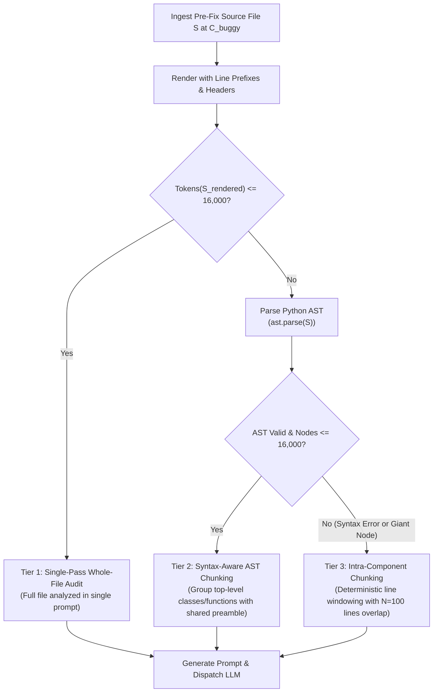
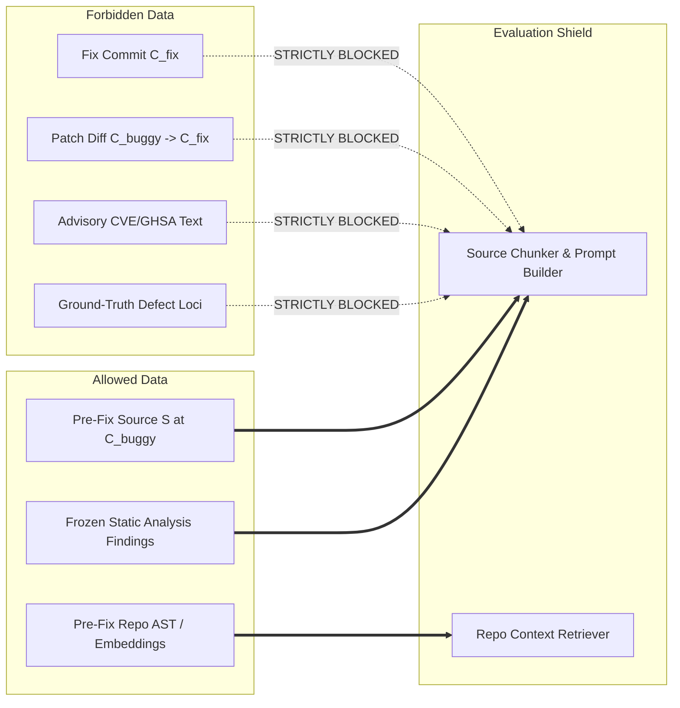

# Whole-File and Component Input Protocol for Configurations A–D

**Version:** 1.0 (Approved Operational Specification — Phase 3B.5)  
**Date:** October 9, 2026  
**Status:** APPROVED SPECIFICATION FOR 17-CASE DEVELOPMENT PILOT  
**Scope:** Defines the source selection, deterministic chunking mechanics, token budget governance, line-coordinate mapping, answer-leakage safeguards, and experimental contrast matrix for Configurations A, B, C, and D across the 17 ground-truth-verified pilot benchmark cases.

---

## 1. Executive Summary & Objective

### 1.1 Objective & Authority
This specification establishes the authoritative, testable engineering protocol defining exactly what source code and auxiliary context Configurations A, B, C, and D ingest when evaluating the 17 ground-truth-verified pilot cases.

In Phase 3B.4, the student formally approved **Option 1 — Whole-File / Component Audit** for the 17-case development pilot (`Project Documents/dataset/evaluation_input_scope_and_filter_spec.md` v3.0). This protocol operationalizes that decision into an unambiguous implementation standard.

### 1.2 Development Pilot Scope vs. Production PR Review Objective
To maintain scientific rigor and prevent methodological conflation, the boundary between the development pilot and the final benchmark is explicitly formalized:

1. **Development Pilot Comparison Scope (17 Cases — Governed by this Spec):**
   - Evaluates Configurations A, B, C, and D on identical, authentic pre-fix source files ($C_{\text{buggy}}$).
   - Serves as the controlled experimental baseline to quantify:
     - The standalone bug-finding capability of static analysis (Config A).
     - The standalone capability of large language models without tooling (Config B).
     - The marginal gain of injecting deterministic static analysis findings into LLM review (Config C).
     - The marginal gain of augmenting LLM review with two-stage repository-level context (Config D).
   - Eliminates artificial line-filtering circularity and ensures 100% cryptographic reproducibility across all 17 cases.

2. **Final Benchmark Evaluation Scope ($\ge 100$ Cases — Future Milestone):**
   - Preserves the core thesis engineering objective: automated auditing of GitHub Pull Request diff hunks.
   - Will evaluate Configurations B, C, and D on authentic pull request diffs once an evidence-gated dataset of $\ge 100$ cases with genuine PR provenance is curated.

### 1.3 Historical Baseline Invariant
Configuration A's original whole-file pilot run (`data/results/config_a_pilot_run.json`), executed and verified in Phase 3B and Phase 3B.1, remains the immutable historical static-analysis baseline:
$$\text{Cases}=17, \quad \text{Predictions}=127, \quad \text{Mechanical TP}=3, \quad \text{FP}=124, \quad \text{FN}=19$$
This artifact must never be overwritten or retroactively modified.

---

## 2. Canonical Pre-Fix Source Definition & 17-Case Per-Case Scope Register

### 2.1 Canonical Source Extraction Method
For each case $c \in \text{PilotCases}$, the canonical source code $S_{\text{raw}}$ is extracted directly from the authentic upstream Git object database at the pre-fix commit revision $C_{\text{buggy}}$:
```bash
git -C <upstream_repo_path> show <buggy_commit>:<target_file>
```
Extraction requirements:
- **Zero Synthetic Edits:** The extracted file bytes must match upstream Git blob storage without manual modification, beautification, or synthetic patch injection.
- **UTF-8 Normalization:** The stream is decoded as UTF-8 (with replacement characters only if invalid bytes occur) and line endings normalized to standard LF (`\n`).
- **Contextual File Distinction:** For CAND-0026 (`paramiko/paramiko`), `paramiko/transport.py` is the sole `target_file` (audit target). `paramiko/common.py` is an explicitly pre-declared `contextual_file` and must not be treated as a primary finding target.

### 2.2 Per-Case Scope Register (18 Verified Cases)
The following register defines the cryptographic provenance, file dimensions, token estimations, and chunking strategy for all 18 ground-truth-verified pilot cases (including CAND-0006, promoted in Phase 3C as the verified replacement for CAND-0003):

| Case ID | Target Repository | Buggy Commit ($C_{\text{buggy}}$) | Target File Path | Exact Lines | Measured Rendered Tokens | Strategy Tier Assignment | Number of Chunks | Line Intervals | Canonical GT Defect Loci | Pilot Status |
| :--- | :--- | :---: | :--- | :---: | :---: | :---: | :---: | :---: | :---: | :---: |
| **CAND-0001** | `tornadoweb/tornado` | `2ca8821d00` | `tornado/http1connection.py` | 833 | 9,935 | Tier 1 (Single) | 1 | `[1, 833]` | `[390, 394]` | **APPROVED** |
| **CAND-0002** | `tiangolo/fastapi` | `210af1fd3d` | `fastapi/routing.py` | 991 | 11,282 | Tier 1 (Single) | 1 | `[1, 991]` | `[498, 502]` | **APPROVED** |
| **CAND-0006** | `scrapy/scrapy` | `f02c3d1dcf` | `scrapy/utils/datatypes.py` | 330 | 2,873 | Tier 1 (Single) | 1 | `[1, 330]` | `[318, 319]` | **APPROVED (Phase 3C)** |
| **CAND-0007** | `tiangolo/fastapi` | `90120dd6e8` | `fastapi/routing.py` | 1,101 | 13,117 | Tier 1 (Single) | 1 | `[1, 1101]` | `[182, 184]` | **APPROVED** |
| **CAND-0008** | `Kludex/python-multipart` | `d3d16dae4b` | `multipart/multipart.py` | 1,893 | 20,401 | Tier 2 (AST) | 2 | `[1, 937]`, `[940, 1893]` | `[72, 75]` | **APPROVED** |
| **CAND-0009** | `pallets/jinja` | `a7863ba9d3` | `src/jinja2/filters.py` | 1,854 | 16,044 | Tier 2 (AST) | 2 | `[1, 1434]`, `[1438, 1854]` | `[250, 250]`, `[292, 293]` | **APPROVED** |
| **CAND-0014** | `django/django` | `425718726b` | `django/db/models/functions/datetime.py` | 415 | 3,760 | Tier 1 (Single) | 1 | `[1, 415]` | `[45, 51]`, `[225, 236]` | **APPROVED** |
| **CAND-0015** | `django/django` | `6b178a3e93` | `django/contrib/postgres/aggregates/general.py` | 63 | 482 | Tier 1 (Single) | 1 | `[1, 63]` | `[54, 58]` | **APPROVED** |
| **CAND-0017** | `tortoise/tortoise-orm` | `816ff00e98` | `tortoise/backends/mysql/executor.py` | 71 | 729 | Tier 1 (Single) | 1 | `[1, 71]` | `[19, 45]` | **APPROVED** |
| **CAND-0019** | `aio-libs/aiohttp` | `33ccdfb0a1` | `aiohttp/web_urldispatcher.py` | 1,252 | 12,022 | Tier 1 (Single) | 1 | `[1, 1252]` | `[574, 576]`, `[643, 645]` | **APPROVED** |
| **CAND-0020** | `pallets/werkzeug` | `50cfeebcb0` | `src/werkzeug/security.py` | 161 | 1,549 | Tier 1 (Single) | 1 | `[1, 161]` | `[151, 157]` | **APPROVED** |
| **CAND-0021** | `encode/starlette` | `24c1fac62a` | `starlette/staticfiles.py` | 246 | 2,495 | Tier 1 (Single) | 1 | `[1, 246]` | `[172, 172]` | **APPROVED** |
| **CAND-0025** | `jpadilla/pyjwt` | `24b29adfeb` | `jwt/algorithms.py` | 680 | 6,447 | Tier 1 (Single) | 1 | `[1, 680]` | `[186, 197]` | **APPROVED** |
| **CAND-0026** | `paramiko/paramiko` | `aefd28a7f0` | `paramiko/transport.py` | 2,673 | 29,978 | Tier 3 (Sliding Window) | 3 | `[1, 1175]`, `[1076, 2143]`, `[2044, 2673]` | `[1822, 1828]` | **APPROVED** |
| **CAND-0027** | `lepture/authlib` | `bb7a315bef` | `authlib/jose/__init__.py` | 73 | 527 | Tier 1 (Single) | 1 | `[1, 73]` | `[49, 49]` | **APPROVED** |
| **CAND-0031** | `jupyterhub/jupyterhub` | `b405361674` | `jupyterhub/apihandlers/users.py` | 931 | 9,882 | Tier 1 (Single) | 1 | `[1, 931]` | `[265, 267]`, `[328, 331]` | **APPROVED** |
| **CAND-0032** | `zulip/zulip` | `ea0b8cc011` | `zerver/lib/message.py` | 1,658 | 17,057 | Tier 2 (AST) | 2 | `[1, 1240]`, `[1243, 1658]` | `[825, 827]`, `[842, 856]` | **APPROVED** |
| **CAND-0033** | `zulip/zulip` | `b1007916b0` | `zerver/actions/typing.py` | 210 | 2,047 | Tier 1 (Single) | 1 | `[1, 210]` | `[83, 85]` | **APPROVED** |

*\*Measured rendered tokens reflect the complete rendered source representation (including 1-indexed line prefixes, file header, and footer) counted by the official Anthropic `/v1/messages/count_tokens` endpoint under the frozen model configuration ($B_{\text{source}} = 16,000$ tokens).*

---

## 3. Deterministic Oversized-File Handling & Syntax-Aware Chunking Policy

### 3.1 Frozen Source Token Budget & Budget Allocation

#### 3.1.1 Fixed Source-Input Budget ($B_{\text{source}} = 16,000\text{ tokens}$)
The source-input budget for the 17-case development pilot is strictly frozen at:
$$B_{\text{source}} = 16,000\text{ tokens}$$
This single value replaces all alternative proposals (such as "16k or 32k"). The 16,000-token value represents the fixed source budget for this development pilot, not an unproven claim that all 17 files fit within a single request. Files whose fully rendered representation exceeds 16,000 tokens must exercise the deterministic chunking policy defined in Section 3.2.

#### 3.1.2 Full Rendered Source Accounting Rule
Token counting for $B_{\text{source}}$ must measure the **complete rendered source representation**, including:
1. Explicit line-number prefix annotations on every line (`<line_number>: <code_line>`).
2. File and chunk boundary header lines (`=== AUDIT TARGET: <path> (Lines S to E) ===`).
3. Any contextual docstrings, preamble headers, or code framing annotations.

Under no circumstances may raw file byte size, character count, or heuristic multipliers (such as $\text{characters} / 3.5$) be treated as proof that an input fits within $B_{\text{source}}$.

#### 3.1.3 Tokenizer Selection & Preflight Validation Requirement
The Large Language Model provider and exact model checkpoint for Configuration B must be selected and frozen in a dedicated specification before executing the first pilot benchmark call. At that time:
1. **Official Tokenizer Requirement:** The system must count tokens using the selected model's official tokenizer (e.g., dedicated tokenizer library or documented, reliable provider token-counting endpoint).
2. **Conservative Fallback Margin:** If neither an official tokenizer library nor a token-counting endpoint is available, the auditor must define and validate a conservative counting method with an explicit, documented safety margin prior to any benchmark invocation.
3. **Context Ceiling Validation:** The system must measure the fully rendered input and validate that the total request—including prompt template, static findings, repository context, and generation reservation—fits safely within the chosen model's actual supported context window.

#### 3.1.4 Non-Overlapping Budget Partitioning
To guarantee reproducible execution and prevent prompt overflow, the total context budget is partitioned into five distinct, non-overlapping allocations:

| Budget Component | Symbol | Allocation | Description & Governance |
| :--- | :---: | :---: | :--- |
| **Source Code Input** | $B_{\text{source}}$ | **16,000 tokens** | **FROZEN PILOT BUDGET.** Dedicated exclusively to fully rendered target source code and line prefixes. |
| **Prompt Template** | $B_{\text{prompt}}$ | $\le 2,000$ tokens | System instructions, role definitions, taxonomy specifications, and JSON output schema. |
| **Static Findings** | $B_{\text{static}}$ | $\le 2,000$ tokens | Auditor-generated findings from frozen ruleset for Configurations C and D. Chunk-filtered when chunking. |
| **Repository Context** | $B_{\text{context}}$ | $4,000$ tokens | AST symbols and deduplicated lexical search excerpts for Configuration D (Option B local fallback; ceiling 4,000; pgvector not used). |
| **Model Generation** | $B_{\text{out}}$ | $2,048$ tokens | Completion token capacity reserved for model output JSON (ceiling 4,096 tokens). |

Total Maximum Request Footprint:
$$B_{\text{total}} = B_{\text{prompt}} + B_{\text{source}} + B_{\text{static}} + B_{\text{context}} + B_{\text{out}} \le 2,000 + 16,000 + 2,000 + 4,000 + 2,048 = 26,048\text{ tokens}$$

### 3.2 Hierarchical Chunking Policy
When auditing any Python source file $S$, the chunking engine applies the following deterministic three-tier hierarchy based on measured rendered tokens:



#### Tier 1: Single-Pass Whole-File Audit
- **Condition:** $\text{Tokens}(S_{\text{rendered}}) \le 16,000\text{ tokens}$.
- **Action:** The complete rendered file is provided in a single prompt. No slicing, partitioning, or chunking is performed.
- **Line Coordinates:** 1 to $\text{total\_lines}$.

#### Tier 2: Syntax-Aware AST Chunking
- **Condition:** $\text{Tokens}(S_{\text{rendered}}) > 16,000\text{ tokens}$, and the source file is syntactically valid Python.
- **Partitioning Algorithm:**
  1. **Shared Preamble Extraction:** Extract lines $1$ through $L_{\text{preamble}}$ consisting of module docstrings, `import` statements, `__all__`, and top-level constants. This preamble is injected as an immutable header in every chunk to preserve symbol definitions.
  2. **Top-Level Structural Units:** Parse all remaining top-level AST nodes:
     - `ast.ClassDef` blocks (including all methods, properties, and class variables).
     - `ast.FunctionDef` and `ast.AsyncFunctionDef` blocks.
     - Top-level statement clusters.
  3. **Greedy Deterministic Grouping:** Iterate through structural units in lexical order. Pack contiguous units into Chunk $k$ until adding the next unit would cause $\text{Tokens}(\text{Preamble} + \text{Units}) > 16,000$. When the limit is reached, close Chunk $k$ and begin Chunk $k+1$.
  4. **Ground-Truth Independence:** The grouping operates strictly in ascending lexical order. No knowledge of defect loci, advisory text, or Git history is accessible to the chunker.

#### Tier 3: Intra-Component Chunking with Deterministic Fixed Overlap
- **Condition:** An individual class or function unit exceeds $16,000\text{ tokens}$ on its own, or AST parsing fails due to syntax incompatibility.
- **Windowing Algorithm:**
  1. Define window line capacity $W$ based on conservative token density.
  2. Define fixed overlap: $N = 100$ lines.
  3. Chunk 1 covers lines $[1, W]$.
  4. Chunk 2 covers lines $[W - N + 1, 2W - N]$, and so forth.
  5. The final chunk ends exactly at $\text{total\_lines}$.

### 3.3 Core Chunking Invariants
All implementations of the chunking engine must adhere to these mathematical invariants:

1. **Complete Line Coverage Invariant:**
   The union of all chunk line intervals must cover the entire source file without gaps:
   $$\bigcup_{k=1}^{K} [\text{start\_line}_k, \text{end\_line}_k] = [1, \text{total\_lines}]$$
2. **Ground-Truth Blindness Invariant:**
   Chunk boundary selection function $f(S, B_{\text{source}})$ must satisfy:
   $$\frac{\partial f}{\partial L_{\text{defect}}} = 0, \quad \frac{\partial f}{\partial \text{Advisory}} = 0$$
   Chunk boundaries are a pure function of source text $S$ and token budget $B_{\text{source}}$.
3. **Boundary Deduplication Invariant:**
   Findings emitted across overlapping chunks (in Tier 3 or across boundary AST nodes) that refer to the identical file path, line coordinate, and CWE ID are merged into a single finding. Distinct CWE classifications at the same line are strictly preserved.

### 3.4 Failure & Fallback Disciplines
- **Parser Failure:** If `ast.parse()` raises `SyntaxError` (e.g., Python version differences), the engine immediately falls back to Tier 3 deterministic line windowing with $N=100$ line overlap.
- **API / Rate Limit Failure:** If any chunk query fails or times out, the evaluation harness enforces **FR-09 Partial-Run Scoring Policy**: all early findings are discarded, and the case is scored as an empty prediction set ($0$ findings emitted).

### 3.5 Configuration C Static Findings Chunk-Filtering and Deduplication Policy
When a target file exceeds $B_{\text{source}} = 16,000$ tokens and is processed across multiple chunks in Configuration C:

1. **Chunk-Level Finding Relevance:** Only inject static findings relevant to the current target file and the specific chunk's source-line span $[chunk\_start_k, chunk\_end_k]$. Static findings situated entirely outside the chunk's line boundaries must not be injected into that chunk's prompt.
2. **Chunk-Boundary Intersection Rule:** A static finding $F$ with canonical line range $[f_{\text{start}}, f_{\text{end}}]$ intersects Chunk $k$ iff:
   $$\max(chunk\_start_k, f_{\text{start}}) \le \min(chunk\_end_k, f_{\text{end}})$$
   If $F$ intersects Chunk $k$, it is formatted into Chunk $k$'s static findings prompt section.
3. **Preservation of Finding Metadata:** Injected static findings strictly preserve canonical absolute source line numbers, normalized file paths, rule IDs, and frozen category and CWE mappings. Line coordinates are never re-indexed relative to chunk start.
4. **Deterministic Multi-Chunk Evaluation Handling:** If finding $F$ intersects multiple overlapping chunks (e.g. across a Tier 3 overlap zone or spanning adjacent AST units), $F$ is presented in each intersecting chunk prompt. During case-level evaluation, predictions emitted across chunks are aggregated and deduplicated using canonical coordinate matching:
   $$\text{Key} = (\text{normalized\_path}, \text{line\_number}, \text{cwe\_id})$$
   This guarantees that no finding is accidentally omitted or counted repeatedly against ground truth.
5. **Ground-Truth Independence:** Static findings must never be filtered, prioritized, or selected using ground-truth defect locations ($L_{\text{defect}}$) or advisory data.
6. **Toolchain Invariance:** The frozen static ruleset, rule-to-CWE mappings, official matcher, and deduplication semantics remain untouched.
7. **Experimental Contrast Invariant:** Configuration C must differ from Configuration B strictly by the addition of auditor-generated static findings, not by altering the target code region or chunk boundaries.

### 3.6 Configuration D Repository-Context Retrieval Deduplication and Target-File Policy
Configuration D augments Configuration C by retrieving cross-file repository context (AST symbol definitions and pgvector semantic chunks up to $B_{\text{context}} = 4,000$ tokens). To avoid redundancy and maintain experimental rigor:

1. **Primary Target Chunk Non-Duplication (Default Rule):** The current target chunk is already provided as primary input and **must not be duplicated** as retrieved repository context. The retriever must exclude the target chunk's line span $[chunk\_start, chunk\_end]$ from retrieval candidates.
2. **Target-File Context Policy:** Chunks from other regions of the same target file may be included in repository context only if there is a documented structural necessity (e.g., cross-component caller/callee or class hierarchy defined outside the current chunk) and a deterministic exclusion/deduplication policy.
3. **Preference for Cross-File Context:** The retriever must preferentially prioritize repository context from other files within the repository when they provide genuinely relevant structural relationships (e.g., imported helper functions, base classes, middleware, request schemas).
4. **Stable Coordinate Deduplication:** All retrieved context chunks must be deduplicated prior to prompt assembly using stable repository-relative file paths and source line intervals $[file\_path, start\_line, end\_line]$. Distinct information from separate files must be strictly preserved.
5. **Post-Deduplication Context Budgeting:** The frozen repository context budget ($B_{\text{context}} = 4,000$ tokens) is enforced strictly after deduplication. If deduplicated candidates exceed $B_{\text{context}}$, structural AST definitions (Tier 1 context) take priority over pgvector vector chunks (Tier 2 context), per ADR-07.
6. **Zero-Leakage Retrieval Invariant:** Retrieval must remain strictly blind to the known defect location, ground-truth labels, CVE/GHSA metadata, and fixing commits. Vector indexes and AST graphs are built strictly from the pre-fix snapshot at $C_{\text{buggy}}$.
7. **Experimental Contrast Invariant:** Configuration D must differ from Configuration C strictly by the addition of repository context, not by duplicating target code or altering the local-code input.

---

## 4. Line-Numbering & Path Normalization Contract

### 4.1 Presentation Layer Format
To enable precise defect localization without byte mutation, source code presented to the LLM must use a standardized 1-indexed line prefix:
```text
<line_number>: <original_source_line>
```
Example:
```python
10: class HTTP1Connection:
11:     def __init__(self, stream: IOStream) -> None:
12:         self.stream = stream
```
**Presentation Invariants:**
- The canonical underlying file on disk or in memory remains unmodified.
- Line numbers in prefixes match the canonical 1-indexed line numbers of the original file at commit $C_{\text{buggy}}$.
- When Tier 2 or Tier 3 chunking is used, lines retain their **global canonical line numbers** (e.g., Chunk 2 covering lines 500–1000 is prefixed with `500:`, `501:`, ..., `1000:`), preventing chunk-relative coordinate disorientation.

### 4.2 Chunk-to-File Coordinate Mapping Contract
Each chunk presented to the LLM includes an explicit scope header:
```text
=== AUDIT TARGET: fastapi/routing.py (Lines 500 to 1101 of 1101) ===
```
The model prompt explicitly instructs:
> *"Cite line numbers exactly as printed in the line-number prefixes. Do not renumber lines starting from 1."*

**Coordinate Normalization Rules:**
1. **Emitted Line Validation:** For any finding $F$ with emitted line range $[l_{\text{start}}, l_{\text{end}}]$:
   $$1 \le l_{\text{start}} \le l_{\text{end}} \le \text{total\_lines}$$
2. **Single-Line to Range Normalization:** If the model emits a single line $l$, it is normalized to $[l, l]$.
3. **Out-of-Range Clamping / Rejection:** If a finding specifies $l_{\text{start}} > \text{total\_lines}$ or $l_{\text{start}} < 1$, the finding is invalid and rejected prior to matcher handoff.

### 4.3 Path Normalization Contract
All reported file paths must be normalized using the existing domain utility `auditor.matcher.path_utils.normalize_path()`:
- Backslashes (`\`) converted to POSIX forward slashes (`/`).
- Leading `./`, `/`, `a/`, or `b/` prefixes stripped.
- Target repository root prefixes stripped to match `case.target_file` exactly.

### 4.4 Offline Evaluation Matcher Parity
Normalized findings are evaluated by `OfflineEvaluationMatcher(tolerance_lines=10)` using Kuhn maximum-cardinality bipartite matching under the frozen taxonomy rules:
- Category matching: Matches if category IDs align (with Category 1 requiring impact alignment).
- CWE matching: Matches if candidate CWE is equal to `primary_cwe` or in `acceptable_alternative_cwes`.
- Location matching: Matches if $|l_{\text{pred}} - l_{\text{gt}}| \le 10$ lines (with range intersection handling).

---

## 5. Frozen Experimental Contrast Matrix (Configurations A, B, C, D)

To ensure scientifically defensible comparisons, all four configurations are evaluated against the exact same source code input ($S_{\text{raw}}$ at $C_{\text{buggy}}$) while isolating the experimental variables:

| Parameter / Dimension | Configuration A (Static Baseline) | Configuration B (Zero-Context LLM) | Configuration C (Static-Augmented LLM) | Configuration D (Full Hybrid Auditor) |
| :--- | :--- | :--- | :--- | :--- |
| **System Architecture Role** | Intra-file static analysis baseline | Zero-context semantic LLM reviewer | Static-guided semantic LLM reviewer | Full context-aware hybrid auditor |
| **Source Code Input** | Target file at $C_{\text{buggy}}$ | Target file at $C_{\text{buggy}}$ (via Tier 1/2/3) | Target file at $C_{\text{buggy}}$ (via Tier 1/2/3) | Target file at $C_{\text{buggy}}$ (via Tier 1/2/3) |
| **Static Analysis Engine** | **Ruff + Semgrep engine + frozen restricted-license rule pack** | **INACTIVE (None)** | **ACTIVE** (Auditor-generated findings from Config A) | **ACTIVE** (Auditor-generated findings from Config A) |
| **Static Findings Injection** | N/A (Emits directly) | **None** | Injected into LLM prompt ($B_{\text{static}} \le 2,000$ tokens, chunk-filtered) | Injected into LLM prompt ($B_{\text{static}} \le 2,000$ tokens, chunk-filtered) |
| **Repository Context Engine** | **INACTIVE (None)** | **INACTIVE (None)** | **INACTIVE (None)** | **ACTIVE** (Option B: AST Symbol Graph + Lexical Search; local fallback without pgvector) |
| **Repo Context Injection** | None | None | None | Injected into prompt ($B_{\text{context}} \le 4,000$ tokens, target chunk excluded) |
| **LLM Execution** | **None** | Candidate LLM (frozen provider, model, prompt, and parameters) | Identical LLM checkpoint and generation parameters as Config B | Identical LLM checkpoint and generation parameters as Config B & C |
| **Prompt Template** | None | Base Review Prompt ($B_{\text{prompt}}$) | Base Review Prompt + Chunk-Filtered Static Findings | Base Review Prompt + Static Section + Deduplicated Repo Context |
| **Tolerance Window** | $\pm 10$ lines (locked) | $\pm 10$ lines (locked) | $\pm 10$ lines (locked) | $\pm 10$ lines (locked) |
| **Taxonomy Governance** | 6 locked categories | 6 locked categories | 6 locked categories | 6 locked categories |
| **Scoring Discipline** | Primary: failed = 0 | Primary: failed = 0 | Primary: failed = 0 | Primary: failed = 0 |

> **Note on Static Analysis Toolchain & Licensing:** The static analysis engine comprises native Ruff 0.16.10 and Semgrep CE 1.180.0 runners executing the version-pinned `python_security.yaml` rule pack vendored in Phase 3B. This rule pack is governed by Semgrep Rules License v1.0 and is restricted to private, local academic research. The repository and its Git history must not be published as-is or pushed to a public remote. The engine and frozen ruleset remain strictly immutable.

### 5.1 Experimental Isolation Invariants
To prevent confounding factors between configurations:
1. **Config B Isolation:** Configuration B must never receive static analysis output or repository context. It receives exclusively the target code (chunked deterministically if exceeding $B_{\text{source}} = 16,000$ tokens) and the base review prompt.
2. **Config C Isolation:** Configuration C must receive static analysis findings generated exclusively by the frozen Config A ruleset, filtered strictly to the active chunk's line boundaries, and must never receive repository context or altered code chunks.
3. **Config D Isolation:** Configuration D receives the union of Config C inputs plus repository context retrieved strictly from the pre-fix repository commit $C_{\text{buggy}}$, with primary target chunks strictly excluded from context duplication.
4. **Contrast Validity Invariant:** Configurations B, C, and D must evaluate identical LLM checkpoints under identical sampling parameters, isolating the contribution of static findings (B $\rightarrow$ C) and repository context (C $\rightarrow$ D).

### 5.2 Reproducibility and Stochasticity Governance
Not every LLM provider exposes a `seed` parameter, and even when a seed is accepted, it does not guarantee bitwise deterministic output on hosted commercial LLM infrastructure (due to non-deterministic GPU kernel scheduling, dynamic mixture-of-experts routing, and floating-point batching).

To establish an honest, defensible scientific methodology without overpromising:
1. **Pre-Execution Parameter Freeze:** The LLM provider, exact model identifier and snapshot version, prompt template version, temperature, token limits, and all supported generation hyperparameters must be selected, recorded, and frozen in the Configuration B specification prior to the first benchmark run.
   - **Provider:** Anthropic Messages API (via local proxy gateway `http://localhost:20128`).
   - **Model:** `Claude Sonnet 4.6` (gateway identifier `ag/claude-sonnet-4-6`).
   - **Adaptive Thinking:** `{"type": "adaptive"}` with `output_config: {"effort": "medium"}`.
   - **Temperature:** Strictly omitted (required by provider when adaptive thinking is active).
   - **Completion Token Ceiling:** 16,384 tokens.
   - **Rendered Source Budget:** $B_{\text{source}} = 16,000$ tokens.
2. **Seed Recording Discipline:** A random seed must be recorded only where explicitly supported by the provider API. The system must not claim deterministic output merely because a seed parameter was passed.
3. **Stochasticity Governance Policy:** The Configuration B development pilot benchmark was executed under the **`single_stochastic_observation`** policy: a single, controlled run across all 18 canonical pilot cases without post-hoc retries, selective cherry-picking, or retrospective tuning.
4. **No Post-Hoc Repeat Adjustments:** The repetition policy was established prior to benchmarking; researchers did not inspect benchmark results and retroactively alter trials or prompts.

---

## 6. Answer-Leakage Safeguards & Reproducibility Manifest Schema

### 6.1 The Five Answer-Leakage Safeguards
Any evaluation of an AI code auditor on historical security vulnerabilities is vulnerable to subtle forms of answer leakage. The following five safeguards are mandatory:



1. **Fix Commit Shield:** The commit SHA, commit message, author notes, and tree state of the fixing commit $C_{\text{fix}}$ are strictly excluded from all prompts, vector stores, and retriever indexes.
2. **Remediation Patch Shield:** The remediation diff ($C_{\text{buggy}} \rightarrow C_{\text{fix}}$) must never be presented to the model or used to guide retrieval.
3. **Advisory & CVE Metadata Shield:** Advisory summaries, vulnerability classifications, CVE/GHSA identifiers, severity scores, reporter names, reproducer test names, and published exploit payloads are strictly barred from prompt injection and vector indexing.
4. **Ground-Truth Loci Shield:** Ground-truth line numbers ($L_{\text{defect}}$) and CWE labels from `data/pilot_cases.json` are isolated strictly to the `OfflineEvaluationMatcher` and must never be exposed to the auditor execution pipeline.
5. **Pre-Fix Retrieval Index Shield:** For Configuration D, the AST symbol graph and pgvector embedding database must be constructed strictly from the repository snapshot at commit $C_{\text{buggy}}$. Indexing any post-fix revisions or remediation pull requests is strictly prohibited.

### 6.2 Reproducibility Manifest Schema
Every benchmark execution run across Configurations A–D must generate a machine-readable JSON execution manifest adhering to this schema:

```json
{
  "$schema": "https://json-schema.org/draft/2020-12/schema",
  "title": "ConfigurationExecutionManifest",
  "type": "object",
  "required": [
    "run_id",
    "configuration",
    "timestamp",
    "case_id",
    "repository",
    "buggy_commit",
    "source_snapshot",
    "token_budget_config",
    "chunks",
    "findings_emitted",
    "matcher_results"
  ],
  "properties": {
    "run_id": { "type": "string" },
    "configuration": { "type": "string", "enum": ["A", "B", "C", "D"] },
    "timestamp": { "type": "string", "format": "date-time" },
    "case_id": { "type": "string" },
    "repository": { "type": "string" },
    "buggy_commit": { "type": "string" },
    "model_metadata": {
      "type": "object",
      "required": ["provider", "model_name", "temperature"],
      "properties": {
        "provider": { "type": "string" },
        "model_name": { "type": "string" },
        "model_version": { "type": "string" },
        "tokenizer_name": { "type": "string" },
        "temperature": { "type": "number" },
        "seed": { "type": ["integer", "null"] },
        "stochasticity_policy": {
          "type": "string",
          "enum": ["single_stochastic_observation", "predeclared_repeated_trials"]
        }
      }
    },
    "token_budget_config": {
      "type": "object",
      "required": ["source_budget", "prompt_budget", "output_budget"],
      "properties": {
        "source_budget": { "type": "integer", "enum": [16000] },
        "prompt_budget": { "type": "integer" },
        "static_budget": { "type": "integer" },
        "context_budget": { "type": "integer" },
        "output_budget": { "type": "integer" }
      }
    },
    "source_snapshot": {
      "type": "object",
      "required": ["file_path", "sha256", "total_lines", "byte_size"],
      "properties": {
        "file_path": { "type": "string" },
        "sha256": { "type": "string" },
        "total_lines": { "type": "integer" },
        "byte_size": { "type": "integer" }
      }
    },
    "chunks": {
      "type": "array",
      "items": {
        "type": "object",
        "required": ["chunk_index", "start_line", "end_line", "token_estimate"],
        "properties": {
          "chunk_index": { "type": "integer" },
          "start_line": { "type": "integer" },
          "end_line": { "type": "integer" },
          "token_estimate": { "type": "integer" },
          "ast_scope_type": { "type": "string" }
        }
      }
    },
    "injected_context": {
      "type": "object",
      "properties": {
        "static_findings_count": { "type": "integer" },
        "static_findings_rule_ids": { "type": "array", "items": { "type": "string" } },
        "ast_symbols_count": { "type": "integer" },
        "pgvector_chunks_count": { "type": "integer" }
      }
    },
    "execution_telemetry": {
      "type": "object",
      "properties": {
        "duration_seconds": { "type": "number" },
        "prompt_tokens": { "type": "integer" },
        "completion_tokens": { "type": "integer" },
        "total_tokens": { "type": "integer" }
      }
    },
    "findings_emitted": {
      "type": "array",
      "items": {
        "type": "object",
        "required": ["finding_id", "file_path", "start_line", "end_line", "category_id", "primary_cwe"],
        "properties": {
          "finding_id": { "type": "string" },
          "file_path": { "type": "string" },
          "start_line": { "type": "integer" },
          "end_line": { "type": "integer" },
          "category_id": { "type": "integer" },
          "primary_cwe": { "type": "string" },
          "confidence": { "type": "number" }
        }
      }
    },
    "matcher_results": {
      "type": "object",
      "required": ["true_positives", "false_positives", "false_negatives", "precision", "recall", "f1"],
      "properties": {
        "true_positives": { "type": "integer" },
        "false_positives": { "type": "integer" },
        "false_negatives": { "type": "integer" },
        "precision": { "type": ["number", "null"] },
        "recall": { "type": ["number", "null"] },
        "f1": { "type": ["number", "null"] }
      }
    }
  }
}
```

---

## 7. Acceptance Criteria & Test Plan

### 7.1 The Eleven Testable Invariants
Any implementation of the input preparation pipeline for Configurations B, C, and D must satisfy the following eleven testable invariant requirements:

| Invariant ID | Name | Formal Assertion / Verification Criterion |
| :--- | :--- | :--- |
| **INV-01** | **Exact Source Parity** | SHA-256 hash of extracted source text matches upstream Git blob at commit $C_{\text{buggy}}$ byte-for-byte. |
| **INV-02** | **Ground-Truth Agnosticism** | Chunk boundary generator produces identical intervals regardless of whether ground-truth loci or advisories are present in memory. |
| **INV-03** | **Complete Line Coverage** | For every case, $\bigcup_{k=1}^K [\text{start}_k, \text{end}_k] = [1, \text{total\_lines}]$ with zero missing lines. |
| **INV-04** | **Bounded Deterministic Overlap** | Consecutive chunks in Tier 3 have exactly $N = 100$ lines overlap; Tier 2 chunks have $0 \le \text{overlap} \le N$. |
| **INV-05** | **Canonical Coordinate Monotonicity** | Every line prefix in prompts matches the 1-indexed line number of the canonical file ($l_i = i$). |
| **INV-06** | **Normalized Finding Bounds** | Every emitted finding satisfies $1 \le \text{start\_line} \le \text{end\_line} \le \text{total\_lines}$. |
| **INV-07** | **Multi-CWE Preservation** | Deduplication across chunk boundaries preserves distinct CWE classifications at identical lines. |
| **INV-08** | **Orthogonal Configuration Isolation** | Config B contains 0 static findings and 0 repo context; Config C contains static findings (chunk-filtered if file is chunked) and 0 repo context; Config D contains both, with the active target chunk strictly excluded from repo context duplication. |
| **INV-09** | **Zero Answer Leakage** | Automated scanner verifies prompt contains 0 occurrences of $C_{\text{fix}}$, patch diff, CVE/GHSA IDs, or GT defect line coordinates. |
| **INV-10** | **Pre-Fix Retrieval Index Cleanliness** | Database query verifies 100% of embedded chunks for Config D originate from commit $C_{\text{buggy}}$ or earlier ancestors. |
| **INV-11** | **Reproducibility Manifest Completeness** | Execution output passes validation against `ConfigurationExecutionManifest` JSON schema with frozen $B_{\text{source}}=16,000$ tokens and recorded model/stochasticity parameters. |

### 7.2 Implementation Test Plan
Before executing any benchmark run for Configurations B, C, or D:
1. **Source Hash Validation Unit Tests:** Validate that all 17 pre-fix source files match the hashes recorded in the Scope Register.
2. **Chunker Unit Tests:** Test AST splitting and Tier 3 sliding window on synthetic and real fixtures (e.g. `multipart.py`, `transport.py`), verifying INV-02, INV-03, and INV-04.
3. **Coordinate Normalization Unit Tests:** Test parsing of various LLM response formats (single-line, range, JSON, markdown) and verify INV-05 and INV-06.
4. **Answer-Leakage Preflight Assertion:** Run automated string and regex inspection on generated prompts before LLM dispatch, asserting INV-09.
5. **Configuration Isolation Spy Tests:** Verify via recording spies that Config B and C dispatchers receive null payloads for disallowed context tiers, asserting INV-08.
